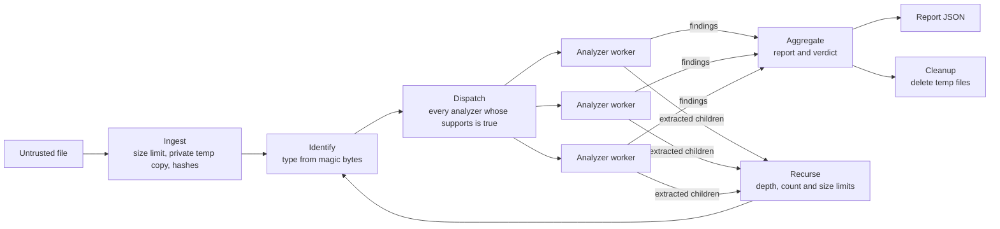

# Architecture

This is the design as built in Phase 0. The code is in `src/filevet/core/`.

## Pipeline



1. **Ingest** rejects files over the size limit (50 MB by default) with a usage error, copies the input into a private temp directory, and computes its SHA-256 and MD5. Each copy is created `0600` and made read-only (`0400`) before any analyzer sees it.
2. **Identify** detects the type from magic bytes with the built-in signature table in `core/identify.py` (see [ADR 9](adr/0009-built-in-type-signatures.md)), and takes the declared type from the extension. If the two contradict each other, `basic.type_mismatch` reports it.
3. **Dispatch** runs every analyzer that supports the artifact, each in its own worker.
4. **Recurse** feeds extracted children (archive entries, PDF attachments, embedded OLE objects) back into Identify, within `max_depth`, `max_children` and `max_total_expanded_bytes`.
5. **Aggregate** builds the report: artifacts, findings, analyzer runs and summary counts. Until the policy engine lands in Phase 3, the verdict follows the highest severity: `high` or `critical` blocks, `medium` needs review, anything lower passes. When a recursion limit is hit, the rest of the extracted content is skipped and the pipeline adds one `pipeline.limit_exceeded` finding (severity `high`) per limit.
6. **Cleanup** always deletes temp files, including after errors.

## Core contracts

There are three contracts. Analyzers depend only on these, never on each other.

**`Artifact`**: one file being scanned, either the input or an extracted child. It's immutable and holds an ID, name, size, hashes, declared and detected types, depth, parent ID and a path to a read-only copy. The pipeline owns the file; analyzers only read it.

**`Analyzer`**: a protocol. `analyze` returns an `AnalyzerResult` with findings and extracted children.

```python
class Analyzer(Protocol):
    name: str
    version: str

    def supports(self, artifact: Artifact) -> bool: ...
    def analyze(self, artifact: Artifact, ctx: AnalysisContext) -> AnalyzerResult: ...
```

**`Finding`**: one observation. It has a stable namespaced `rule_id` (`parser.csv_formula_injection`), title, description, severity (`info` to `critical`), confidence, artifact ID, location (page, cell, XPath, byte offset or archive path), evidence of at most 256 escaped characters, references (CVE, CWE, OWASP) and the analyzer that produced it.

The pipeline stamps each finding with the artifact ID and the analyzer's name and version, so an analyzer only fills in what it observed.

Findings say what was seen. The policy decides what to do about it (block, review or pass with findings), so changing the policy never means changing an analyzer.

The JSON schema of the report, which includes `Finding` and `Artifact`, is a public contract. It's committed at [schema/report.schema.json](schema/report.schema.json) and printed by `filevet schema`. A test fails if the two drift apart. All three models are pydantic models ([ADR 7](adr/0007-pydantic-models.md)).

## Isolation model

Every analyzer run gets its own forked process with a wall-clock timeout (30 s by default) and a memory cap (1 GB by default, via `RLIMIT_AS` on Linux). The process handles one artifact and is then killed, so no state leaks between files. It sends its result back as JSON, which the pipeline validates against `AnalyzerResult` before using it. Nothing crosses the boundary as a pickle. If an analyzer times out, crashes, raises, returns something invalid or sends a result that's too large, the scan records a `pipeline.analyzer_error` finding with severity `high` and goes on with the other analyzers. Only the exception type goes into the report, never its message, because a message can quote file contents. The reasons are in [ADR 6](adr/0006-subprocess-isolation-v0.md).

Logs hold hashes, rule IDs and timings only, never file contents.

This is isolation v0. Phase 4 replaces it with a `Sandbox` interface and stronger backends: no network, read-only filesystem, seccomp and dropped privileges.

## Plugin model

Analyzers are found through the `filevet.analyzers` entry point group. [CONTRIBUTING.md](../CONTRIBUTING.md#writing-a-new-analyzer) shows how to register one.

Built-in analyzers register the same way as third-party ones, so a separate package can add analyzers without forking filevet ([ADR 8](adr/0008-entry-point-plugins.md)). `filevet analyzers` lists everything registered and the detected types each one supports. It works that out by calling `supports()` once per known type. The test suite includes a separate example plugin package in `tests/plugin/`.

## Decisions

The reasons behind these choices are recorded in [adr/](adr/).
