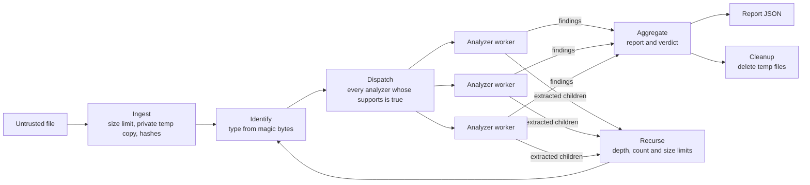

# Architecture

This is the design that Phase 0 builds. It will be updated as the code lands.

## Pipeline



1. **Ingest** rejects files over the size limit (50 MB by default), copies the input into a private temp directory with `0600` permissions, and computes its hashes.
2. **Identify** detects the type from magic bytes. If it contradicts the declared type, `basic.type_mismatch` reports it.
3. **Dispatch** runs every analyzer that supports the artifact, each in its own worker.
4. **Recurse** feeds extracted children (archive entries, PDF attachments, embedded OLE objects) back into Identify, within `max_depth`, `max_children` and `max_total_expanded_bytes`.
5. **Aggregate** builds the report: artifacts, findings, analyzer runs and summary counts. The verdict comes from the policy.
6. **Cleanup** always deletes temp files, including after errors.

## Core contracts

There are three contracts. Analyzers depend only on these, never on each other.

**`Artifact`**: one file being scanned, either the input or an extracted child. It's immutable and holds an ID, name, size, hashes, declared and detected types, depth, parent ID and a path to a read-only copy. The pipeline owns the file; analyzers only read it.

**`Analyzer`**: a protocol. `analyze` returns an `AnalyzerResult` with findings and extracted children.

```python
class Analyzer(Protocol):
    name: str
    version: str

    def supports(self, artifact: Artifact) -> bool: ...
    def analyze(self, artifact: Artifact, ctx: AnalysisContext) -> AnalyzerResult: ...
```

**`Finding`**: one observation. It has a stable namespaced `rule_id` (`parser.csv_formula_injection`), title, description, severity (`info` to `critical`), confidence, artifact ID, location (page, cell, XPath, byte offset or archive path), evidence of at most 256 escaped characters, references (CVE, CWE, OWASP) and the analyzer that produced it.

Findings say what was seen. The policy decides what to do about it (block, review or pass with findings), so changing the policy never means changing an analyzer.

## Isolation model

Every analyzer runs in a separate subprocess with a wall-clock timeout (30 s by default) and a memory cap (1 GB by default, via `RLIMIT_AS` on Linux). A worker serves one task and then exits, so no state leaks between files. If an analyzer times out or crashes, the scan records a `pipeline.analyzer_error` finding with severity `high` and goes on with the other analyzers.

Logs hold hashes, rule IDs and timings only, never file contents.

This is isolation v0. Phase 4 replaces it with a `Sandbox` interface and stronger backends: no network, read-only filesystem, seccomp and dropped privileges.

## Plugin model

Analyzers are found through the `filevet.analyzers` entry point group. [CONTRIBUTING.md](../CONTRIBUTING.md#writing-a-new-analyzer) shows how to register one.

Built-in analyzers register the same way as third-party ones, so a separate package can add analyzers without forking filevet. `filevet analyzers` lists everything registered.

## Decisions

The reasons behind these choices are recorded in [adr/](adr/).
