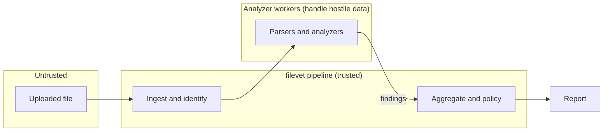

# Threat model

This covers the threats filevet looks for in files and the threats against filevet itself. Every file filevet reads may be hostile, so its own parsers are a target.

## Assets

- The host running filevet: its filesystem, network access, credentials and other workloads.
- The scanned files: they often hold personal and financial data, so their contents must not leak through logs, reports or temp files.
- The integrity of the report: a downstream system trusts the verdict. An attacker who can suppress findings or change the verdict can push a malicious file through.
- The release supply chain: the PyPI package, the container image and their signatures.

## Attackers

- The file author is the main attacker. They fully control the bytes of the file, and possibly the file name and declared type. They don't control filevet's configuration or the host. They may know exactly which version of filevet is running and craft files to target it.
- A supply chain attacker tries to get malicious code into filevet's dependencies, build or release.
- A malicious contributor submits a PR that weakens a check or adds a backdoor.

## Trust boundaries

1. File → pipeline. Everything about the file is untrusted, including its name, size, declared type and every byte.
2. Pipeline → analyzer workers. Parsers are the most exposed code, so they run in isolated workers with time and memory limits. We assume a parser can be compromised by a crafted file.
3. Workers → aggregation. Findings coming back from a worker are data. They're validated against the `Finding` model, and their evidence is truncated and escaped before it reaches the report.

## What filevet must defend against

| Threat | Mitigation |
| --- | --- |
| Parser exploits (memory corruption in native libraries, logic bugs) | Each analyzer in its own subprocess, one task per worker; stronger sandbox in Phase 4; fuzzing in Phase 4 |
| Denial of service: zip bombs, entity expansion, huge or deeply nested structures | Input size limit, per-analyzer timeout and memory cap, recursion depth, child count and expanded-size limits checked while streaming |
| XXE and network access from parsers | `defusedxml` or `lxml` with entities and network off; no network in the container; network blocked in the Phase 4 sandbox |
| Path traversal and symlinks during extraction | Entries are checked before extraction, symlinks are rejected, children are written only inside the private temp directory |
| Execution of embedded content | filevet never runs, renders or opens a file with an external program |
| Data leaking through logs or reports | Logs hold hashes, rule IDs and timings only; evidence is truncated and escaped (see [architecture](architecture.md#core-contracts)) |
| Injection into whatever reads the report (terminal escapes, HTML, CSV formulas) | Evidence is escaped; the table view strips control characters |
| Evasion: making an analyzer crash or time out to hide findings | A crash or timeout becomes a `high` severity finding, never a silent pass |
| Leftover files on disk | Temp files are deleted after every scan, including on error |
| Supply chain compromise | Locked dependencies, license and vulnerability checks in CI, signed releases with SBOMs, trusted publishing without stored tokens |
| Malicious PRs | Code owner review on every change, required CI checks, no real malware in the repository |

## Out of scope

- An attacker who already controls the host or filevet's configuration.
- Malware that filevet has no rule for. A missed detection is a bug to fix, but filevet never claims to catch everything.
- What happens to the file after filevet hands back its report.
